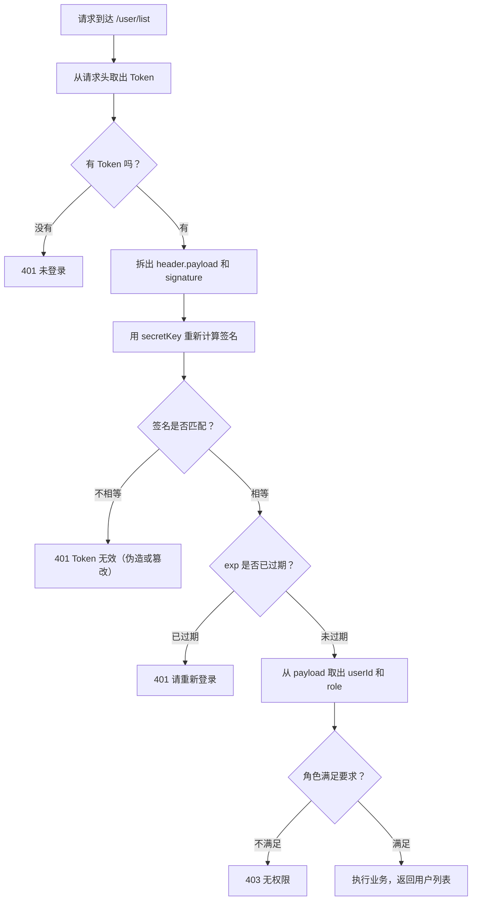
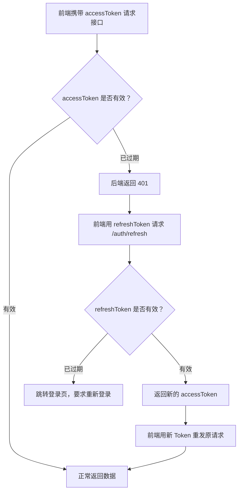
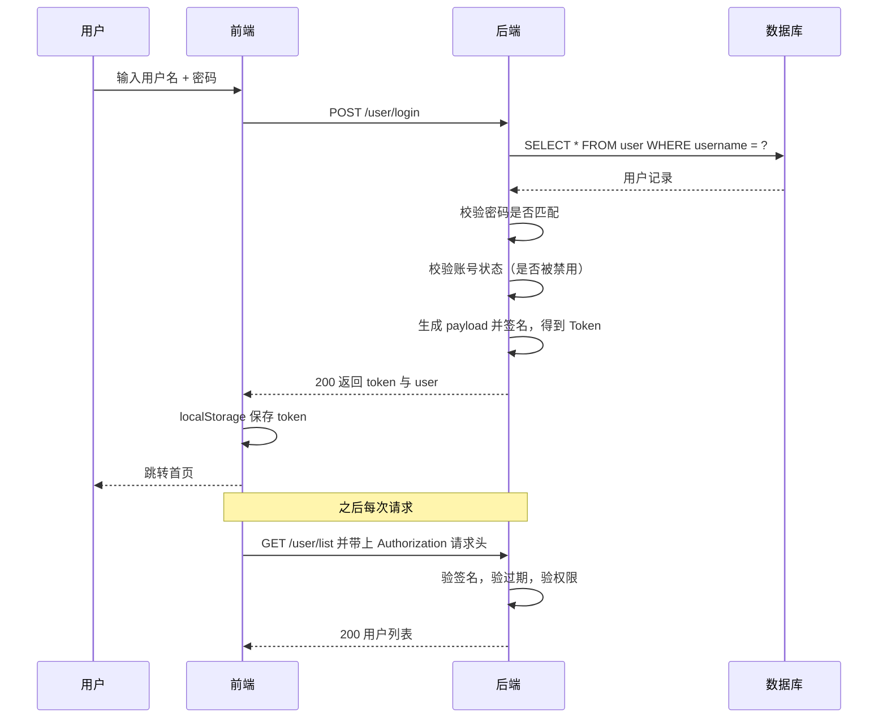
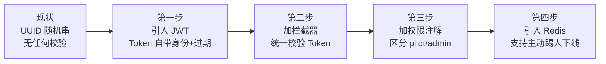
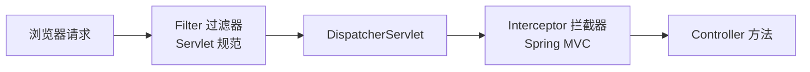

# 登录与 Token：从一次请求说起

> 面向初级工程师的学习文档。读完后你应该能回答：Token 是什么、为什么需要它、
> 怎么生成、怎么验证、怎么过期、怎么续期，以及"用户列表接口该不该要求管理员权限"。

---

## 一、先看一个具体的场景

用户登录成功后，后端返回了这样一个东西：

```json
{
  "state": 200,
  "message": "登录成功",
  "data": {
    "token": "3d6de3a0700142dbbc88c030f85741c3",
    "user": { "id": 1, "username": "13800001001", "name": "张伟", "permission": "pilot" }
  }
}
```

前端把它存进 `localStorage`，之后访问任何页面都带着它。

问题来了：**这个莫名其妙的字符串到底有什么用？**

- 它长得像随机数，人看不懂 —— 这是故意的。
- 但服务端能看懂 —— 它记录了"你是谁、你能干什么、什么时候过期"，并且带有防伪标记。
- 前端不需要看懂，只需要：**存好它、每次带上它**。

---

## 二、用户列表接口，要不要登录？

假设现在要访问用户列表 `GET /user/list`。有两种产品设计：

| 设计 | 产品逻辑 | 技术实现 |
|---|---|---|
| A. 公开接口 | 任何人都能看 | 不需要任何校验 |
| B. 受保护接口 | 必须登录 **且** 是管理员 | 需要证明身份 + 证明权限 |

现实中，用户列表通常属于 B。那么问题就变成了：

> **后端怎么知道"你"是管理员，而且你确实登录成功了？**

HTTP 是**无状态**的 —— 每个请求都是独立的，后端默认不认识你。你上一秒登录成功，下一秒再请求，后端根本不记得你是谁。

所以必须让前端在每个请求里**带上一个凭证**，向后端证明自己的身份。

---

## 三、为什么不直接带上用户名和密码？

这是最直觉的方案：既然要证明身份，那就把用户名密码存本地，每次请求带上。

**从结果上看，它能工作。但从安全上看，它是灾难：**

1. **暴露面被放大**。密码每次请求都在网络上传输，任何一个环节（代理、日志、抓包）都可能泄露。密码泄露是"长期有效"的，用户改密码之前攻击者一直能用。
2. **无法表达权限之外的信息**。后端每接到一个请求都要查库、比对密码，压力大且没必要。
3. **无法主动失效**。想把某个用户踢下线，只能靠改密码 —— 而这会影响他所有设备。
4. **明文存储在前端**，一个 XSS 漏洞就全丢了。

于是需要一个东西，它满足：

- 服务端能从中**读出用户身份**（人看不懂没关系）
- **不可伪造**（用户改不了内容）
- **有有效期**（过期自动作废）
- **可以主动作废**（能把人踢下线）

这个东西就是 **Token**。

---

## 四、Token 是什么

一句话定义：

> **Token 是服务端签发的、包含身份信息、带有防篡改签名的字符串。它是你的"电子通行证"。**

关键在于"签名"。Token 不是随便生成的随机串（本项目当前实现就是随机串，后面会讲它的局限），而是一段**有结构的数据 + 一段签名**。

### JWT：最主流的 Token 格式

JWT（JSON Web Token）长这样：

```
eyJhbGciOiJIUzI1NiJ9.eyJ1c2VySWQiOjEsInJvbGUiOiJhZG1pbiJ9.4m4X7...
└──── header ────┘ └──────── payload ────────┘ └─ signature ─┘
```

它由三部分组成，用 `.` 分隔：

| 部分 | 内容 | 示例（Base64 解码后） |
|---|---|---|
| header | 用了什么算法 | `{"alg":"HS256"}` |
| payload | 携带的数据 | `{"userId":1,"role":"admin","exp":1735660800}` |
| signature | 签名 | 一串二进制摘要 |

**这里有个必须知道的坑：**

> payload 只是 **Base64 编码**，不是加密！任何人复制这段字符串到 [jwt.io](https://jwt.io) 都能看到里面的内容。

所以：
- ✅ 可以放：用户 ID、角色、过期时间
- ❌ 绝对不能放：密码、手机号、身份证号等敏感信息

那安全性从哪来？**从签名来** —— 下面讲。

---

## 五、Token 如何生成

### 要包含什么

```json
{
  "sub": "1",              // 用户标识（subject）
  "role": "admin",         // 角色/权限，避免每次查库
  "iat": 1735657200,       // 签发时间 issued at
  "exp": 1735660800,       // 过期时间 expires at
  "iss": "drone-server"    // 签发者 issuer
}
```

### 用什么算法

| 算法 | 类型 | 特点 | 适用场景 |
|---|---|---|---|
| **HS256** | 对称加密 | 同一个密钥签发和验证 | 单体应用（**本项目推荐**） |
| RS256 | 非对称加密 | 私钥签发、公钥验证 | 微服务、第三方开放平台 |

HS256 的签发过程：

```
signature = HMAC-SHA256( base64(header) + "." + base64(payload), secretKey )
```

**`secretKey` 是整个体系的命根子**：它只存在于服务端，一旦泄露，任何人都能签发合法 Token。必须放在环境变量或配置中心，绝不能提交到代码仓库。

---

## 六、Token 如何验证

用户带着 Token 来了，后端怎么判断它是不是伪造的？



**为什么伪造不了？**

- 攻击者改了 payload（比如把 `"role":"pilot"` 改成 `"role":"admin"`）→ 签名对不上 → 拒绝
- 攻击者自己造一个 Token → 没有 `secretKey`，算不出正确签名 → 拒绝

**注意一个细节**：验证签名是"用密钥重新算一遍再比对"，服务端**不需要查库**就能确认 Token 合法。这叫**无状态验证**，是 JWT 最大的优势 —— 但也埋下了"无法主动失效"的隐患（见下一节）。

---

## 七、Token 如何过期

### 1. 自然过期

payload 里的 `exp` 字段。校验时拿到当前时间一比，过期就拒绝。

这是最基本的一层 —— 即使 Token 泄露，攻击者能用的时间窗口也有限。

### 2. 主动失效：纯 JWT 做不到的事

现在有个真实问题：

> 用户张伟的 Token 还有 6 天才过期，但今天管理员发现他在干坏事，把他的账号禁用了。
> **此时他手里的 Token 还能用吗？**

**能。** 因为 JWT 是无状态的 —— 服务端只管验签名，根本不查用户是否被禁用。这就是用户提出的问题：

> "管理员发现了，把用户禁用了，token 应该也同时要禁用"

要解决它，必须引入**状态**。常见方案：

| 方案 | 做法 | 优缺点 |
|---|---|---|
| **黑名单** | 把失效的 Token 存 Redis，校验时查一下 | 简单直接；需要 Redis，且要处理黑名单自身的过期 |
| **版本号** | 用户表加 `token_version`，签发时写进 payload，校验时比对 | 改密码/禁用时版本 +1，该用户所有 Token 立即失效 |
| **短 Token + 每次查库** | Token 只活 15 分钟，校验时顺带查用户状态 | 兼顾安全与性能，但每次要查库 |

**结论**：JWT 解决的是"不查库验证身份"，但业务的"我要立刻踢人下线"需求，必须靠外部状态来兜底。**安全性和便利性永远是权衡**。

---

## 八、Token 如何续期

### 问题

- Token 有效期设 10 分钟 → 用户每 10 分钟就要重新登录一次，体验极差
- Token 有效期设 30 天 → 泄露后攻击者能玩一个月

### 方案一：滑动过期（简单粗暴）

每次请求成功时，服务端重新签发一个新 Token 返回，前端替换旧的。

- 效果：**你一直在操作，就永远不会被登出；你放置不动，过期时间一到就得重新登录**
- 缺点：每个请求都要重签，且服务端拿不到 Token 就没法主动续（前端得配合替换）

### 方案二：双 Token（主流做法）

发放两个 Token：

| Token | 有效期 | 作用 |
|---|---|---|
| **accessToken** | 短（15 分钟 ~ 2 小时） | 访问业务接口时携带 |
| **refreshToken** | 长（7 天 ~ 30 天） | 专门用来换新的 accessToken |



**这正好对应你举的银行 App 例子：**

- 你一直在操作 → accessToken 过期时自动续 → 你感觉不到，一直能用
- 你放着不动半小时 → accessToken 和 refreshToken 都过期 → 重新登录

**续期续的是谁？续的是 accessToken。** 而 refreshToken 的寿命决定了"最长可以多久不登录"。

### 前端配合要点

用 axios 的响应拦截器统一处理：

```js
service.interceptors.response.use(
  (res) => res,
  async (error) => {
    if (error.response?.status === 401 && !error.config._retry) {
      error.config._retry = true          // 防止无限重试
      const newToken = await refreshToken()
      error.config.headers.Authorization = `Bearer ${newToken}`
      return service.request(error.config) // 重发原请求
    }
    return Promise.reject(error)
  },
)
```

两个容易踩的坑：
1. **并发请求**：同时发出 5 个请求都 401，会触发 5 次刷新。需要加锁，只刷新一次，其余等结果。
2. **刷新接口自身 401**：不能再触发刷新，否则死循环。

---

## 九、完整登录流程图



---

## 十、落到本项目：现状与改造路径

### 改造前的问题

最初 `UserServiceImpl.login()` 的实现是：

```java
return new UserLoginVO()
        .setToken(UUID.randomUUID().toString().replace("-", ""))  // 一个随机串
        .setUser(userVO);
```

它是一个**随机 Token**，特点是：

- ✅ 前端可以存下来，用来判断"本地是否有登录状态"
- ❌ **服务端完全不认识它** —— 没存起来，也没法验证，谁拿着它都能过
- ❌ 没有用户信息、没有过期时间、没有签名

也就是说：**现在的 Token 只是个摆设**。回到第 2 节的问题 —— 如果把 `/user/list` 改成"需要管理员"，用现在的 Token 是拦不住任何人的，因为后端根本没法验证它。

### 改造步骤



**第一步：引入 JWT（已完成）**

```xml
<dependency>
    <groupId>io.jsonwebtoken</groupId>
    <artifactId>jjwt-api</artifactId>
    <version>0.12.6</version>
</dependency>
```

```java
String token = Jwts.builder()
        .subject(String.valueOf(user.getId()))
        .claim("role", user.getPermission())
        .issuedAt(new Date())
        .expiration(new Date(System.currentTimeMillis() + 2 * 60 * 60 * 1000)) // 2 小时
        .signWith(secretKey)
        .compact();
```

密钥配置在 `application.yml`，并改用环境变量注入（不要提交到仓库）：

```yaml
drone:
  jwt:
    secret: ${JWT_SECRET:dev-only-secret-please-change-in-production}
    expire-hours: 2
```

**第二步：写拦截器（已完成）**

`AuthInterceptor` 从 `Authorization: Bearer 你的token` 中取出 Token，交给 `JwtUtil` 解析校验；
失败直接返回 401，通过后把 `LoginUser` 放进 `UserContext`（底层是 ThreadLocal），业务层用 `UserContext.get()` 就能拿到当前登录人。

**第三步：加权限控制（待做）**

自定义注解 `@RequireRole("admin")` + 拦截器解析，比配置式更灵活。

**第四步：主动失效（待做）**

把"被禁用的用户 ID"或"Token 的 jti"放进 Redis 黑名单，校验时查一次。

### 拦截器还是过滤器？

两者都能"在请求到达业务代码之前插一脚"，但站的位置不同，能力也不同。



| 维度 | Filter 过滤器 | Interceptor 拦截器 |
|---|---|---|
| 规范 | Servlet 规范 | Spring MVC 规范 |
| 作用范围 | 所有请求（含静态资源、非 Spring 的 Servlet） | 只对进入 DispatcherServlet 的请求生效 |
| 执行时机 | DispatcherServlet 之前 | Handler 之前 / 之后 / 视图渲染后 |
| 能否注入 Bean | 默认不能，得手动从容器里取 | 可以，本身就是 Spring Bean，直接构造注入 |
| 能否知道目标方法 | 不能 | 能拿到 `HandlerMethod`，可读方法上的注解 |
| 典型用途 | 编码转换、跨域、请求日志、XSS 过滤 | 登录校验、权限校验、参数预处理 |

**本项目选拦截器**，两个理由：

1. **要注入 `JwtUtil` 和 `ObjectMapper`** —— 拦截器是 Spring Bean，构造注入就行；过滤器默认不归 Spring 管，得绕一圈。
2. **给第三步留路** —— 后面要做 `@RequireRole("admin")`，必须能知道目标方法上有没有这个注解，这只有拦截器能办（`preHandle` 的 `handler` 参数就是 `HandlerMethod`）。

反过来说，如果需求只是"统一处理编码""记一下请求日志""给所有响应加个头"，过滤器反而更合适 —— 它连静态资源的请求都能覆盖到。

**一个必须注意的细节**：`afterCompletion` 里一定要清理 `ThreadLocal`。

Tomcat 的线程是复用的，不清理的话，A 用户的身份会"粘"在线程上，被下一个复用该线程的请求读到 —— 这是很隐蔽的越权漏洞，而且极难复现。所以 `UserContext.clear()` 不能省。

---

## 十一、常见误区清单

- ❌ **"Token 是加密的，用户看不到内容"** → JWT 的 payload 只是 Base64，肉眼可读，别放敏感数据
- ❌ **"把密码存到 localStorage，每次请求带上"** → 能用，但等于把家里的钥匙复制一把贴门上
- ❌ **"前端判断有没有 Token 就等于安全了"** → 前端校验只是**体验优化**（决定显示登录页还是首页），真正的安全边界永远在服务端
- ❌ **"Token 有效期设长一点，用户就不烦了"** → 泄露后的风险窗口同步变长，正确做法是双 Token
- ❌ **"把 secretKey 写在代码里提交到 Git"** → 等于把印章放在公共桌上
- ❌ **"用了 JWT 就没法踢人下线"** → 纯 JWT 确实做不到，需要黑名单/版本号兜底

## 十二、安全存储位置的取舍

Token 存在哪里，也是一个安全问题：

| 位置 | XSS 风险 | CSRF 风险 | 说明 |
|---|---|---|---|
| `localStorage` | 高（JS 能读） | 无 | 简单，前端手动带 Header，**本项目当前选择** |
| `sessionStorage` | 高 | 无 | 关标签页即失效 |
| `HttpOnly Cookie` | 低（JS 读不到） | 高（自动携带） | 更安全，但需要处理 CSRF |

没有绝对安全的方案。`localStorage` + 严格的 XSS 防护（Vue 默认转义、CSP 头）是常见取舍。

---

## 十三、面试题

> 按「基础 → 安全 → 过期续期 → 场景设计」排列。答案尽量说人话，不背术语。

### 基础概念

#### Q1. HTTP 是无状态的，那服务器怎么知道我已经登录了？

HTTP 就像每次见面都失忆的门卫 —— 你上午登记过，下午再来他完全不记得你是谁。

Token 就是门卫在你登记后发的**访客证**。下次进门直接亮证，他看证上的防伪标记就知道你是谁、能进哪层楼，不用翻登记簿。

#### Q2. Token 和 Session 有什么区别？该用哪个？

区别的根源是「**登录状态存在哪**」：

- **Session**：状态存在服务端（内存或 Redis），前端只拿一个没含义的 `sessionId`。每次请求服务端都要查「这个 id 对应谁」。
- **Token（JWT）**：状态写在 Token 自己身上，服务端验个签名就行，不用查库。

打个比方：Session 像**寄存处的号码牌**，牌子本身没信息，得拿它去柜台查包裹；Token 像**身份证**，上面直接写着你是谁，看一眼就能辨真假。

单机应用两者都行；要多台服务器、要跨服务，选 Token 省事 —— 它不依赖某一台机器的内存。

#### Q3. JWT 由哪几部分组成？

三段，用 `.` 分隔：`header.payload.signature`。

- header：说明用了什么签名算法
- payload：装用户信息和过期时间
- signature：签名，防篡改

#### Q4. JWT 的 payload 每个人都能解码看到，那还安全吗？

安全，但**前提是你别往里放敏感信息**。

payload 只是 Base64 编码，不是加密 —— 复制到网上任何 JWT 调试工具都能看内容。它的安全性不在「藏起来」，而在「改不了」：任何一处改动都会让签名对不上，服务端直接拒绝。

所以 payload 里只放用户 ID、角色、过期时间这类「被人看到也无所谓」的东西。密码、身份证号绝对不能放。

#### Q5. 为什么不能把用户名密码存在前端，每次请求都带上？

技术上跑得通，但等于**把家里钥匙复制一把贴在门上**。

密码是长期有效的凭证 —— 一旦泄露，攻击者在你改密码之前都能随便用。而请求要经过浏览器、代理、日志、监控多个环节，任何一环被抓包，密码就没了。Token 不一样，它有时效、能作废，泄露的损失可控。

顺带一提：每次请求都传密码，也意味着服务端每次都得查库比对密码，白白增加压力。

#### Q6. 前端明明有 token，为什么不能说「已经安全了」？

因为前端校验只能决定**显示哪个页面**，拦不住任何人。

你可以直接在浏览器里手动塞一个假 token 进 `localStorage`，前端该放行还是放行。真正的安全边界永远在服务端 —— 服务端必须自己验一次签名和权限，而不是相信前端说「我有票」。

一句话：**前端校验是体验优化，服务端校验才是安全。**

#### Q7. Token 和 sessionId 都是一个字符串，本质区别在哪？

sessionId 是**钥匙**，本身没信息，必须去服务端查对应的柜子。

Token 是**身份证**，信息就印在上面，服务端自己就能验证真伪。

这带来两个直接后果：Token 天然适合多机部署（不用共享存储），但也天生没法「远程注销」（你把身份证发出去了，收不回来）。

#### Q8. 用户登录成功后，返回的 token 里到底应该装什么？

最小必要原则：

- 装：用户 ID（sub）、角色/权限、签发时间（iat）、过期时间（exp）、签发者（iss）
- 不装：密码、手机号、身份证、银行卡，以及任何「泄露了会让人难受」的东西

放角色的目的是省一次查库 —— 校验时直接知道你是不是管理员。但如果权限经常变，就得权衡：是每次查库保证实时，还是接受一定延迟。

### 安全

#### Q9. 攻击者能不能伪造一个 Token？

理论上不能，只要 `secretKey` 没泄露。

伪造的思路无非两种：

1. **自己造一个** —— 但没有密钥就算不出正确签名，服务端一验就露馅
2. **改现成的** —— 比如把自己的角色从 `pilot` 改成 `admin`，但改了 payload，签名就对不上

这就是签名的意义：**内容可以公开，但改一个字就不认。**

#### Q10. 用户改了密码，之前发出的 Token 还能用吗？

**默认能用**，这是个真实的安全漏洞。

因为 JWT 是无状态的，服务端只管验签名，根本不知道密码已经变了。旧 Token 在过期之前依然畅通无阻 —— 意味着如果账号被盗、用户改了密码，攻击者手里的 Token 还能继续用。

解决办法是引入状态：用户表加一个 `tokenVersion` 字段，签发时写进 payload，改密码时版本 +1。校验时一比对，旧 Token 全部作废。

#### Q11. 管理员禁用了某个用户，怎么让他的 Token 立刻失效？

这就是「JWT 没法主动踢人」的经典问题，三种常见解法：

| 方案 | 做法 | 代价 |
|---|---|---|
| 黑名单 | 把失效 Token 塞进 Redis，校验时查一次 | 要维护 Redis，还要处理黑名单自身的过期 |
| 版本号 | payload 里带版本，禁用时版本 +1 | 要查库，或者把版本缓存在 Redis |
| 短 Token | 只活 15 分钟，校验时顺带查用户状态 | 兜底有延迟，最长 15 分钟内还能作恶 |

面试时如果只答「用 Redis 存黑名单」，通常会被追问「黑名单什么时候清、Key 怎么设计」—— 想清楚再说。

#### Q12. Token 存 `localStorage` 还是 `Cookie`？

各有各的坑，没有完美方案：

| 位置 | 怕什么 | 为什么 |
|---|---|---|
| `localStorage` | XSS | JS 能随便读，页面被注入脚本就全丢了 |
| `HttpOnly Cookie` | CSRF | 浏览器自动携带，容易被诱导发起请求 |

`localStorage` 需要前端手动往请求头里塞 Token，所以不怕 CSRF，但怕 XSS。
`HttpOnly Cookie` 反过来，JS 读不到所以不怕 XSS 偷，但会自动携带，所以怕 CSRF（需要配 `SameSite` 和 CSRF Token）。

#### Q13. XSS 和 CSRF 分别是什么？跟 Token 有什么关系？

- **XSS**：攻击者把恶意脚本注入到你的页面里，脚本能读到 `localStorage` → **偷走 Token**
- **CSRF**：攻击者诱导你点击一个链接，浏览器自动带上 Cookie 去请求你的银行 → **冒用你的身份**

一句话区分：XSS 是「**偷令牌**」，CSRF 是「**借令牌**」。

Token 放 `localStorage` 免疫 CSRF（因为不会自动携带），但 XSS 一旦发生就直接失守 —— 所以 Vue 的自动转义、CSP 响应头这些防护不能省。

#### Q14. `secretKey` 泄露了会有什么后果？

**全线失守，比任何一个用户密码泄露都严重。**

有了密钥，攻击者可以给任何人签发合法 Token —— 包括管理员身份的、有效期十年的。服务端验证签名时完全看不出异常，因为签名确实是对的。

所以密钥必须：放环境变量或配置中心、不进代码仓库、定期轮换、不同环境用不同的值。

### 过期与续期

#### Q15. Token 有效期设多长合适？

没有标准答案，本质是拿**安全性**换**用户体验**：

- 太短（5 分钟）：安全，但用户频繁被踢出去
- 太长（30 天）：省事，但泄露后攻击者能用一个月

工程上的标准解法不是「找一个折中的值」，而是**用两个 Token**（下一题）。

#### Q16. 什么是双 Token 机制？为什么不只用一个？

发两个 Token，各司其职：

- **accessToken**：短命（15 分钟 ~ 2 小时），访问接口时用
- **refreshToken**：长命（7 ~ 30 天），专门用来换新的 accessToken

为什么不只用一个长的？因为 accessToken 每次请求都要在网络上飞，暴露机会多，所以让它短命；refreshToken 只在换票时才用，暴露机会少，所以能长命。

这就像**门禁卡 + 补办凭证**：门禁卡丢了很快失效，但你可以用补办凭证换张新的，不用每次都去前台重办。

#### Q17. 用户一直在操作，Token 会过期被登出吗？

好的实现不会。两种做法：

- **滑动过期**：每次请求成功，服务端重新签发一个 Token 返回，前端替换旧的。你一直在用，就一直不过期。
- **自动续期**：accessToken 快过期时，前端用 refreshToken 悄悄换一张新的，用户完全无感。

对应你举的银行 App 例子：你不停操作，就一直能用；放着不管半小时，refreshToken 也过期了，才需要重新登录。

#### Q18. 同时发出 5 个请求都返回 401，前端该怎么处理？

**必须加锁，否则会刷新 5 次。**

思路是：第一个 401 触发刷新，把刷新动作存成一个 Promise，后面 4 个请求不重复刷新，而是 `await` 同一个 Promise，等新 Token 到手后一起重发。

两个容易踩的坑：

1. **无限循环**：刷新接口自己返回 401 时不能再触发刷新，否则死循环
2. **重试风暴**：重发请求要打标记（如 `_retry = true`），失败就直接抛出，不再重试

#### Q19. 要实现「记住我，7 天不用登录」，怎么设计？

把 7 天加在 **refreshToken** 上，而不是 accessToken 上。

accessToken 保持 15 分钟 ~ 2 小时的短命，refreshToken 的过期时间设成 7 天。用户 7 天内回来，自动用 refreshToken 换新的 accessToken，感觉上就是「一直登录着」；超过 7 天，老老实实重新输密码。

这样既满足体验，又没有让一个长期有效的凭证在网络上反复传输。

### 场景设计

#### Q20. 微服务架构下，多个服务怎么共享登录状态？

这正是 JWT 的主场。

传统 Session 方案下，用户登录后状态存在 A 服务的内存里，请求打到 B 服务就不认识了，得搞 Session 共享（Redis 集中存，或粘性会话），很别扭。

JWT 方案下，各个服务只要**共享同一个 `secretKey`**（或者用 RS256 时共享公钥），谁拿到 Token 都能独立验证，不需要互相调用、也不依赖某个共享存储。这是无状态设计最大的好处。

#### Q21. 单点登录（SSO）用 Token 怎么实现？

核心思路是「**一次登录，多系统通行**」。

典型流程：用户访问系统 A，A 发现未登录，跳到统一认证中心；用户在认证中心登录成功后拿到 Token；回到 A 时带上这个 Token，A 去认证中心验证签名的合法性，通过就放行。

系统 B、C 同理 —— 它们都信任认证中心的签名，所以不用各自再登一次。这也是 OAuth2 里 ID Token 的基本原理。

#### Q22. 密码应该怎么存？

**永远不要存明文。** 这是底线中的底线。

- 明文：数据库被人拖库，所有用户密码瞬间裸奔
- MD5/SHA1：早就被彩虹表攻破，而且不加盐的话，相同密码哈希值一样，一撞库就能批量还原
- **BCrypt / Argon2**：正确选择。自带随机盐，计算慢（故意让你暴力破解不划算），还能调难度系数

顺带说一句：本项目的 `user` 表目前是明文 `123456`，这是开发阶段的临时做法，上线前必须换掉。

#### Q23. 登录失败时，为什么「用户名不存在」和「密码错误」要返回同样的提示？

为了防止**用户名枚举**。

如果分开提示，攻击者就能拿一个字典批量试探：「提示用户不存在」→ 这个账号没注册；「提示密码错误」→ 这个账号真实存在。几轮下来就能摸清你平台上哪些手机号是注册过的，为后续的撞库、短信轰炸做准备。

所以正确做法是统一返回「用户名或密码错误」，让攻击者分不清是哪一种。

本项目的 `UserServiceImpl` 就是这么写的。

#### Q24. 怎么防止有人暴力破解登录接口？

几个层次叠加着来：

1. **失败次数限制**：同一账号连续失败 5 次，锁定 15 分钟或要求图形验证码
2. **IP 限流**：单 IP 单位时间内的登录请求数做限制
3. **验证码**：失败几次后强制人机校验，挡住脚本
4. **登录日志与告警**：短时间内大量失败要能报警

注意别只按账号锁 —— 攻击者会换账号刷，所以 **IP 维度**和**账号维度**都要有。

---

## 附：一页速查

```
登录      POST /user/login   { username, password }  →  { token, user }
带 Token  Authorization: Bearer <token>
验 Token  验签名 → 验过期 → 验权限
Token 内容 sub(用户) + role(权限) + iat(签发) + exp(过期)
签名算法  HS256（对称，单体应用首选）
核心密钥  secretKey，只存服务端，泄露 = 全线失守
过期策略  短期 accessToken + 长期 refreshToken
主动失效  黑名单（Redis）或版本号（DB），纯 JWT 做不到
前端职责  存 Token、带 Token、401 时自动续期
服务端职责 签发、验证、过期、失效——安全边界只在这里
```
