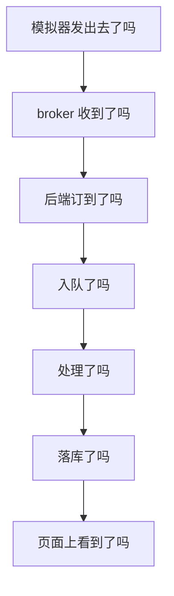

# 端到端联调方案

> **这份文档的状态：设计，未实施。**
> 模拟器脚本还没写（本文只给行为与参数设计），联调也还没跑。
> 文中标注了每一步**依赖哪些功能**，以及哪些功能**必须先实施**才能验。

## 这一篇要解决什么

要把这条链路跑成一个闭环，并且**能反复验证**：

```
管理员建任务 → 派发 → 飞手接受（开始执行）→ 设备持续上报（正常 + 异常）
                                                      ↓
                                            证据落库、任务被标「已证实」
                                                      ↓
                                        飞手完成任务（报告 + 照片 + 日志）
                                                      ↓
                                            资源释放、管理端看到报告
```

两个目标：

1. **写一个 Python 模拟器**，扮演无人机设备，会发正常数据、也会发异常数据
2. **一次完整的联调**，并且留下的东西能重复用（自动化用例 + 手工手册）

---

## 一、先分清三种「验证」，它们不能互相替代

| | 自动化端到端用例 | 手工联调 | 单元/集成测试 |
|---|---|---|---|
| 跑什么 | 真连 broker、真发报文、真调接口 | 真起三个服务 + 浏览器 + 模拟器 | 不起外部进程 |
| 能证明 | **链路通**，且以后每次改动都能重跑 | **人看到的东西对**（页面、推送、提示） | **逻辑对** |
| 不能证明 | 页面长得好不好看、推送提示是否醒目 | 以后每次改动不会退化（要人工重跑） | 链路是否真的通 |
| 跑一次多久 | 十几秒 | 十几分钟 | 几秒 |

**所以两样都要**，各自补对方的短板：

- 自动化用例是**回归防线**：以后改坏了会先红
- 手工联调是**验收**：确认这套东西「用起来是对的」，而不只是「测试是绿的」

**还有一个只有手工联调能发现的问题**：日志好不好看懂、报错信息说不说得清楚、
页面上那个数字放在了让人看不见的角落 —— 这些自动化用例永远测不出来。

---

## 二、前置准备

### 2.1 环境清单（本机现状已核实）

先说一件容易踩的事：**这台机器上有两组容器在抢同一个端口**
（两个 EMQX 容器都映射 1883、两个 MySQL 容器都映射 3306），
所以「先看谁在跑」比「照着名字敲命令」重要。下面每行都是实际 `docker inspect` 出来的。

| 组件 | 现状 | 需要做什么 |
|---|---|---|
| **EMQX** | 有两个容器、**都映射 1883**：`emqx`（emqx/emqx:latest，最近今天启动过一次，但 11 秒就退了）与 `iot`（emqx:5.7，最后一次运行是两个月前）。**目前两个都没在跑** | **二选一起一个**（见下面的命令）。**不能同时起** —— 会撞 1883 |
| **MySQL** | drone 项目的库在容器 **`drone-mysql`**（mysql:8.0，环境变量 `MYSQL_DATABASE=drone`），**当前是停止状态**。而 3306 现在被**另一个项目的**容器 `mtp-mysql` 占着（它的初始化脚本挂在 `open-agent-lab/multi-tenant-platform/` 下，不是本项目的） | 要跑后端，得先把 `drone-mysql` 起起来。**但它和 `mtp-mysql` 都占 3306** —— 要么先停掉 `mtp-mysql`（那是另一个项目的库，你自己判断），要么给其中一个换端口 |
| **后端** | 未运行 | `mvn -o spring-boot:run`（端口 8080） |
| **管理端** | 未运行 | `cd drone-web && npm run dev`（端口 5173）。**接口指向哪个后端**由 `.env.development` 的 `VITE_PROXY_TARGET` 决定（默认 8080）；要指向别的实例，用 `VITE_PROXY_TARGET=http://localhost:8081 npm run dev` 覆盖 —— **不要改 `vite.config.ts`，它读的就是这个环境变量，改了不生效** |
| **飞手端** | 未运行 | `cd drone-app && npm run dev:h5`（端口 5174）。⚠️ 它的代理目标**写死在 `vite.config.ts` 里**（没有对应的环境变量），要指向别的后端只能临时改那一行、验完改回来 |
| **附件目录** | 由后端启动时自动创建 | `drone-server/data/upload`（可用 `DRONE_UPLOAD_ROOT` 覆盖）。**已在 `.gitignore` 里**——里面是真实照片与飞行日志，不能进仓库。联调完记得清掉自己造的测试文件 |
| **Python** | 3.13.5，**`paho-mqtt 2.1.0` 已安装** | 无需操作（这就是选 Python 的原因） |
| **备用发报工具** | `mosquitto_pub` 2.1.2、`mqttx` 1.11.1 CLI 都装了 | 手工补发单条报文时很好用 |

> ⚠️ **上面这条 MySQL 现状是本轮才发现的**：本会话早些时候后端连
> `localhost:3306/drone` 还是通的（端到端用例真的写进去过数据），
> 那是 `drone-mysql` 还在跑的时候；它昨天停机后，`mtp-mysql` 在今天上午占了 3306，
> 于是同样的 `root/root` 就变成了 `Access denied`。
> **看到 `Access denied` 先查是谁占着 3306，不要去改密码** ——
> 换密码解决不了「连错库」这件事。

### 2.2 逐个确认「真的就绪了」

每起一个都**当场验证**，别攒到最后一起查（这样出错时不用猜是哪一环）:

```bash
# 0. 先看端口被谁占着（这一步能省掉后面一半的困惑）
lsof -nP -iTCP:1883 -sTCP:LISTEN
lsof -nP -iTCP:3306 -sTCP:LISTEN
docker ps --format '{{.Names}}\t{{.Status}}\t{{.Ports}}' | grep -E '1883|3306'

# 1. 起一个 EMQX（二选一，别都起）
docker start emqx          # 或 docker start iot
lsof -nP -iTCP:1883 -sTCP:LISTEN     # 应该有输出
open http://localhost:18083          # Dashboard，默认 admin / public，生产必须改

# 2. 起 drone 自己的库（注意它和另一个项目的 mtp-mysql 抢 3306）
docker start drone-mysql
mysql -h127.0.0.1 -uroot -proot -e 'SELECT 1'    # 能通再往下
#    通不了先看 3306 是不是被 mtp-mysql 占着（见 2.1 的提醒）

# 3. 后端：日志里应该看到订阅成功的编号日志（见 MQTT与设备接入.md 4.9.1）
mvn -o spring-boot:run        # 另开一个终端
#   【MQTT 0 启动】→ 【MQTT 6 回调】订阅成功：topic=drone/+/telemetry ...
```

**后端起不来而 EMQX 没起是正常的** —— 订阅器连不上只会每 30 秒重试一次，
不会让后端启动失败（这是刻意设计的，见 `TelemetrySubscriber` 的注释）。
反过来说：**`【MQTT 6 回调】订阅成功` 没出现，就别往下走**，
后面的链路一定不通。

### 2.3 账号与设备（种子数据）

| 角色 | 账号 | 密码 | 备注 |
|---|---|---|---|
| 管理员 | `13800001005` | `123456` | 刘洋 |
| 飞手 | `13800001001` | `123456` | 张伟 |

设备：`UAV-001` ~ `UAV-006`。

> ⚠️ **以你库里实际状态为准，不要背种子数据。**
> 种子文件里 `UAV-001` 是待命、`UAV-006` 是飞行中，但开发库被手工操作过，
> 现在的实际状态可能不同。**联调前先查一次**：

```sql
-- 挑一台待命的设备做联调，并确认它的设备编号
SELECT id, code, name, status FROM `drone` WHERE status = 'idle';

-- 有没有「执行中」的任务？（决定能不能验证「任务被标已证实」）
SELECT t.task_no, t.status, t.evidence_state, d.code AS drone_code
FROM `task` t JOIN `drone` d ON d.id = t.drone_id
WHERE t.status = 'executing';
```

### 2.4 一个建议：把「声明过期」的阈值临时调小

默认 `drone.mqtt.evidence-stale-seconds: 120`（2 分钟），
联调时验证「设备不发数据 → 证据标过期」要干等 2 分钟。建议临时改成 20：

```bash
mvn -o spring-boot:run -Dspring-boot.run.arguments=--drone.mqtt.evidence-stale-seconds=20
```

**改完记得改回去**（或者干脆用命令行参数覆盖，不动 `application.yml`，
这样就不会忘记提交一个被改小的配置）。

---

## 三、Python 模拟器设计

### 3.1 为什么是 Python

- 本机 **`paho-mqtt 2.1.0` 已经装好了**，零安装直接跑（这是决定性理由）
- 写 MQTT 发布端就二十来行，不需要框架
- 参数化、场景化、随时改随时跑，比 Java 轻

**位置**：`tools/drone-simulator/simulator.py`（不进 `drone-server` 的构建，
它是一个独立小工具，跟服务端没有编译期关系）

### 3.2 命令行参数

```bash
python3 tools/drone-simulator/simulator.py \
  --broker   mqtt://localhost:1883 \
  --device   UAV-001 \
  --scenario normal \
  --interval 1.0 \
  --duration 60 \
  --battery-start 100 \
  --keepalive 5 \
  --verbose
```

| 参数 | 默认 | 说明 |
|---|---|---|
| `--broker` | `mqtt://localhost:1883` | broker 地址 |
| `--device` | 必填 | 设备编号。**必须已经在设备档案里登记**，否则数据会被后端丢掉（第 ③ 步「找设备」失败） |
| `--scenario` | `normal` | 见 3.3 |
| `--interval` | `1.0` | 遥测发送间隔（秒） |
| `--duration` | `0`（一直发） | 发多久后正常退出 |
| `--battery-start` | `100` | 起始电量，用来构造电量告警场景 |
| `--keepalive` | `5` | **刻意设小**，为了让遗嘱（LWT）在联调时几秒内就能看到（见 3.5） |
| `--gps-loss-after` / `--gps-loss-seconds` | `3` / `10` | 第几个周期开始丢定位、持续几个周期 |
| `--link-loss-after` / `--link-loss-seconds` | `3` / `30` | 第几个周期开始停发、持续几个周期 |
| `--kill-after` | `10` | `sudden-kill` 跑多少秒后强杀 |
| `--fault-after` | `8` | `fault` 跑多少秒后连发三个问题事件 |
| `--verbose` | 关 | 每条报文都打一行，联调时开着 |

### 3.3 场景清单

| 场景 | 怎么模拟 | 用来验证什么 |
|---|---|---|
| `normal` | 每秒一条遥测（经纬度缓慢漂移、电量缓慢下降）；连上先发 retained 的 `status=online`；中途发一次 `event/takeoff`，退出前发 `event/land` | 证据正常落库；任务 `evidence_state` 从 `declared` 抬到 `confirmed`；**正常飞行应当零告警** |
| `battery-low` | 电量从 `--battery-start` 快速下降，跌破 15 时发一条 `event/battery-low` | 遥测类（`bat.low`/`bat.critical`）与事件类（`evt.battery.low`）**两条通道各报一条** —— 顺带印证「遥测是我们判的、事件是设备判的」 |
| `gps-loss` | 中途把 `gpsLevel` 降到 0 并持续 10 秒，然后恢复 | 连续异常数据；告警的**抑制规则**（持续问题只留一条未处理的） |
| `link-lost` | 中途**停发遥测** N 秒但**保持连接**（心跳还在） | 后端的「声明过期」扫描是否把它标成 `stale`（要把 2.4 节的阈值调小才看得到） |
| `zone-breach` | 从起飞点朝 `--zone-lng/--zone-lat` 直线飞，`--zone-reach-after` 秒后抵达并**停在区内**（⚠️ 目标点填**地图上读到的坐标**：地图是 GCJ-02，模拟器会自己换算成设备上报的 WGS84） | 空间类告警：进「完全禁飞」的区 → `zone.breach`（critical）；在「限高区」里且 `--cruise-alt` 超过限高 → `zone.alt.over`（warning）。停在区内也**只留一条**未处理的（靠现成的抑制规则） |
| `sudden-kill` | 跑够指定秒数后直接 `os._exit(1)`，**不走优雅断开** | **遗嘱（LWT）是否被 broker 代发**，以及后端把它落成 `device.offline` —— 这是最值得验的一条 |
| `fault` | 跑够指定秒数后连发 `event/rth` → `mission-interrupt` → `emergency-stop`，然后正常退出 | **事件类告警的翻译与级别**：warning / critical / critical 三条一次跑完 |

### 3.4 报文格式与三条硬约束

topic 与信封严格照 `MQTT与设备接入.md` 4.4 / 4.13 —— 那批报文是逐条核对过的，
不要自己发挥：

```
遥测   drone/{设备编号}/telemetry     QoS 0
事件   drone/{设备编号}/event/{类型}  QoS 1
状态   drone/{设备编号}/status        QoS 1

{"deviceCode":"UAV-001","type":"position","observedAt":"2026-09-23 10:31:02",
 "seq":10231,"payload":{"lng":116.397,"lat":39.908,"alt":120.5,"speed":8.2,"battery":87}}
```

**三条不能违反的约束**（违反了会静默丢数据，而且看起来「像是后端坏了」）：

1. **`seq` 必须严格递增**。不变的话第二条开始全部被唯一索引挡下 ——
   这是去重在正常工作（4.13 的 B1）。**这是最容易让人误判「后端有问题」的一条。**
2. **`observedAt` 必须是后端认得的格式**（推荐 `yyyy-MM-dd HH:mm:ss`）。
   认不出来整条被丢（4.13 的 C2）。不要为了「测试异常」而故意发一个坏时间，
   除非你就是要验那条丢弃逻辑。
3. **设备编号在 topic 与报文里都写对**。两者不一致时**以 topic 为准**（4.13 的 D），
   报文里的会被忽略并打一条 warn —— 所以 topic 写错了，报文里写对也没用。

### 3.5 遗嘱（LWT）：优雅退出与「被杀」必须是两条不同的路

这是模拟器设计里**最容易做错、也最有价值**的一点。

| 退出方式 | broker 的行为 | 后端看到什么 |
|---|---|---|
| **优雅退出**（`--duration` 到时，或 Ctrl-C） | 脚本自己发一条 `status=offline`（retained）再 `disconnect()` | 「设备主动说它下线了」 |
| **异常掉线**（`sudden-kill` 走 `os._exit`，或 `kill -9`） | 连接没有正常关闭，**broker 在 keepalive 超时后代发遗嘱** | 「broker 替设备说它下线了」 |

**为什么 `--keepalive` 默认设成 5 秒**：mqtt 的遗嘱不是断线立刻发的，
而是 broker 等到「约 1.5 × keepalive」还收不到心跳才判定失联。
如果用默认的 60 秒，联调时要等一分半才能看到遗嘱 —— 没人会等。
设成 5 秒，大约 8 秒后就能看到，联调体验完全不同。

**连接时怎么声明遗嘱**（伪代码，示意参数位置）：

```python
client.will_set(
    topic=f"drone/{device}/status",
    payload=json.dumps({"deviceCode": device, "type": "status",
                        "observedAt": now_str(), "seq": next_seq(),
                        "payload": {"flightState": "offline"}}),
    qos=1,
    retain=True,          # 保留消息：新订阅者立刻能看到「这台设备当前离线」
)
```

**为什么要 `retain=True`**：设备掉线是一件「状态」，不是一瞬间的事件。
新来的订阅者应该立刻知道「这台设备现在是离线的」，而不是等下一次掉线。

> **实现上的一个坑**：`will_set` 必须在 `connect()` **之前**调用。
> 连接之后再设是无效的（协议规定遗嘱是 CONNECT 报文的一部分）。

### 3.6 「异常告警」现在能验到哪一步

告警的五步（识别落库 → 管理端页面与闭环 → 通知 → 事件类与状态类 → 飞手端）
**都已做完**，所以异常数据现在是一条完整的可见链路：

| 现在能看到 | 现在还看不到 |
|---|---|
| 异常报文被收下、归档进 `task_evidence` | 设备详情页上的「该设备未处理告警数」（一直没做） |
| 被识别成一条告警落进 `task_alert` | 90 天清理任务（第七步，可选） |
| 日志里有 `【MQTT 处理 ⑦ 告警识别】新增告警：…` | 告警转成维修任务之类的联动（开放问题 5，暂不做） |
| **管理端右上角弹出提示**，点「去处理告警」跳到 `/alert` | 飞手端**回看自己拍的照片**（只显示文件名，开放问题 14） |
| 告警列表页里认领 / 标记已处理 / 标记误报，写处置说明 | |
| **飞手端任务卡片的告警角标**、展开后的只读清单（需要动手的显式写出「该做什么」） | |
| **飞手端现场异常上报**（选类型 + 说明 + 可选拍照），管理端详情里能看到并下载那张照片 | |
| **任务详情里的「本任务期间的告警」**（按时间排，含「上报时还没有任务、所以 task_id 为空」的那些） | |

**验证时按这条顺序看**（哪一环断了就停在哪一环）：
① 模拟器日志有没有发出去 → ② 后端日志 `【MQTT 处理 ⑤ 幂等落库】insertIgnore 返回 1`
→ ③ 后端日志 `【MQTT 处理 ⑦ 告警识别】新增告警：…`
→ ④ 后端日志 `告警通知已推送：… 送达连接数=N`
→ ⑤ 页面上弹出的提示。

**④ 的「送达连接数=0」是正常的**，意思是「那一刻没有人在线」——
它证明的是「找人这一步做了」，不是「人收到了」。要看到 ⑤，得先把管理端页面开着。

> **一个已知的干扰源**：**保留消息会在后端每次重启、重新订阅时被重放**。
> 所以「当前处于离线」的设备会在后端启动时各产生一条 `device.offline`。
> 排查时看到「刚启动就冒出几条离线告警」，原因在这里，不是链路坏了。

### 3.7 输出与可观测性

模拟器自己要把「我发了什么」打清楚，联调时才能一眼对上后端的日志：

```
[10:31:02] seq=10231  telemetry  电量=87% 位置=116.397,39.908 高度=120.5m
[10:31:03] seq=10232  telemetry  电量=86% 位置=116.398,39.909 高度=121.0m
[10:32:15] seq=10303  event/battery-low  电量=14%
[10:33:40] ---- 模拟异常掉线（os._exit），遗嘱将由 broker 代发 ----
```

格式建议：`时间 + seq + 类型 + 关键字段`，一行一条。
**不要打整段 JSON** —— 联调时人眼要扫的是「有没有在发、发了什么类别」，
原始 JSON 在需要时用 `--verbose` 单独看。

### 3.8 已经实现（2026-09-23）

脚本在 **`tools/drone-simulator/simulator.py`**（Python + paho-mqtt，本机已装 2.1.0，
零安装直接跑）。下面这些命令都实际跑过：

```bash
# 正常飞行 8 秒（预期：只有证据、零告警 —— 正常飞行不该报警）
python3 tools/drone-simulator/simulator.py --device SIM-001 --duration 8

# 电量告警：从 17% 开始快降（预期：bat.low 一条 + bat.critical 一条）
python3 tools/drone-simulator/simulator.py --device SIM-001 --scenario battery-low --battery-start 17 --duration 10

# 定位丢失（预期：gps.lost 一条）
python3 tools/drone-simulator/simulator.py --device SIM-001 --scenario gps-loss --duration 8

# 只停发数据但连接还在（配合把 evidence-stale-seconds 调小，验「声明过期」）
python3 tools/drone-simulator/simulator.py --device SIM-001 --scenario link-lost --link-loss-seconds 30

# 突然掉线（预期：约 1.5×keepalive 后，订阅端能收到 broker 代发的遗嘱）
python3 tools/drone-simulator/simulator.py --device SIM-001 --scenario sudden-kill --kill-after 5

# 设备自己判定出问题（预期：evt.rth 一条 warning、evt.mission.interrupt 与 evt.emergency.stop 各一条 critical）
python3 tools/drone-simulator/simulator.py --device SIM-001 --scenario fault --fault-after 8
```

**实测结果**（后端跑在 8081、EMQX 在 1883）：

| 场景 | 结果 |
|---|---|
| `normal` | 13 条证据（1 在线 + 1 起飞 + 9 遥测 + 1 降落 + 1 离线）、**0 条告警** |
| `battery-low` | 2 条告警（`bat.low` / `bat.critical` 各 1）+ 17 条证据 |
| `gps-loss` | 1 条 `gps.lost` |
| `sudden-kill` | 订阅端在约 8 秒后收到 broker 代发的 `status/offline` |
| `fault`（2026-09-24 加） | 4 条告警：`evt.rth`(warning) + `evt.mission.interrupt`(critical) + `evt.emergency.stop`(critical) + `device.offline`(warning)；`takeoff`/`land`/`online`/正常遥测**零告警**，15 条证据一条不少 |
| `sudden-kill`（2026-09-24 复测） | `os._exit(1)` 后**约 2 秒** broker 就代发了遗嘱（进程猝死时 TCP 直接断开，broker 不必等 keepalive 超时），后端落成一条 `device.offline` |

**两个实测才发现的问题**（都已修进代码与文档）：

1. **阈值类告警会每秒刷一条**：10 秒的低电量产生了 11 条告警
   （16~17% 时 4 条 `bat.low`、13~15% 时 7 条 `bat.critical`），全指向同一个问题。
   根因是设计文档里「设备侧负责限频」那句话对阈值类**不成立** ——
   设备根本没报过这种告警，是服务端每条遥测算一次算出来的。
   已改成「同一问题还有未处理的告警就不再重复产生」，实测从 11 条收敛到 2 条
   （详见 `告警体系设计.md` 4.4 节）。
2. **遗嘱里的 `observedAt` 只能写「连接时那个时刻」**：报文内容在 CONNECT 里就定死了，
   而设备什么时候死是定不下来的。实测：连接于 15:10:53、死于 15:11:00，
   遗嘱里写的还是 15:10:53。所以判断「设备何时离线」要看**我们收到的时刻**
   （`reported_at`），而不是遗嘱里那个时间戳。
   **做离线告警（第四步）时验证过这一点**：2026-09-24 复测，`observed_at = 10:58:00`
   （连接那一刻）而 `reported_at = 10:58:07`（我们收到的时刻），差了 7 秒。

**第三个问题（2026-09-23 补，你跑 60 秒时发现的）**：

模拟器**自己的热模型写错了** —— 原来是 `38 + tick*0.3`（每秒涨 0.3℃、永不收敛），
跑满 60 秒就是 38+18 = 56℃，正好越过后端 55℃ 的阈值，
于是**一次完全正常的飞行被报了一条「电池温度偏高」**。这是模拟器的锅，不是后端判错了。

改成了向稳定温度逼近的模型（`32℃ → 45℃`，时间常数 40 秒）：
60 秒约 42℃、10 分钟 45℃，离阈值有距离 ——「正常飞行零告警」这个预期才站得住。

> **顺带记一个方法论上的教训**：上面那张实测表里「`normal` → 0 条告警」，
> 当时是**跑 8 秒**得出的结论 —— 8 秒时温度才 40℃，当然不会报警。
> **只跑短短一段，验证不了「趋势类」的东西**：温度、电量这些是随时间变化的，
> 要跑到它该出问题的时间尺度上才看得见。
> 这次是你跑了 60 秒才把它暴露出来的。

**还有一处也要改**：原来摘要日志只打了电量/高度/定位/信号/速度/状态，
**漏了电池温度** —— 于是那条温度告警在模拟器日志里根本对不上线索。
现在摘要会把**所有可能触发告警的字段**都打出来（见 `LOG_FIELDS`）。
教训：摘要日志的字段清单必须和后端判定的字段一一对应，少打一个就把线索藏起来了。

**设备侧要报的字段**（少报一个，对应的告警就永远不会触发，而且不会有任何报错）：
`battery` / `batteryTemp` / `gpsLevel` / `signal` / `alt` / `speed` / `sdFreeGb` /
`motorState` / `flightState`。其中 `flightState` 在起降阶段应报
`taking_off` / `landing` 而不是 `flying` —— 否则后端会在每个架次开头报一条
「低于安全高度」（详见 `AlertDetector` 的类注释）。

> **一个容易误判的现象**：`link-lost` 场景下模拟器**保持连接**、只是不发数据；
> `sudden-kill` 才是让连接异常断开。两者看着都像「没数据了」，但机制完全不同 ——
> 排查时先确认**连接还在不在**（看 broker 的在线客户端数），再谈后端行为。

---

## 四、自动化端到端用例清单

放在 `drone-server/src/test/java/cn/tedu/drone/` 下新建一个类
（照 `MqttSubscriberTests` 的做法：`@BeforeAll` 用 `assumeTrue` 探活、
统一前缀清理数据、轮询数据库等结果）。**不能加 `@Transactional`** ——
消费线程在另一个线程、另一个事务里，回滚了就看不到。

### 4.1 主线用例（一条跑完闭环）

| 步骤 | 动作 | 断言 |
|---|---|---|
| 1 | 管理员登录、建任务、建设备、建飞手 | 任务状态 `pending` |
| 2 | 派发 | 任务 `dispatched`；设备 `assigned`；飞手 `busy` |
| 3 | 飞手登录、开始执行 | 任务 `executing`；`actual_start_time` 有值；设备 `flying`；`evidence_state = declared` |
| 4 | 通过 Paho 发一条遥测 | 轮询到证据落库；`evidence_state` 变 `confirmed` |
| 5 | 上传附件（报告相关） | 附件行落库、文件真的在磁盘上 |
| 6 | 飞手完成任务（带报告） | 任务 `finished`；`actual_end_time` 有值；设备回 `idle`；飞手回 `idle`；`task_report` 有一行；`task_log` 多一条 action=`finish` |

**第 6 步是重点**：它同时验了「三线收尾」（状态 / 资源 / 交付物），
和 `任务收尾与执行报告.md` 3.3 节那个**顺序陷阱**（先改状态再统计飞手还有没有活）。

### 4.2 分支用例

| # | 场景 | 期望 |
|---|---|---|
| 1 | 飞手完成**别人**的任务 | 403「这条任务不是派给你的」 |
| 2 | 重复完成（已 `finished` 再调一次） | 状态机拒绝，提示当前状态 |
| 3 | `declared`（还没收到遥测）时完成 | **允许**（见 `任务收尾与执行报告.md` 开放问题 3），但报告上应能看到「仅声明」 |
| 4 | 附件不属于本任务 | 报错，不落库（防越权） |
| 5 | 附件超过大小上限 | 报错，提示具体上限 |
| 6 | 完成后**飞手手上还有别的活** | 飞手**不**回 `idle`（这条专门盯 `countActiveByPilot` 的逻辑） |
| 7 | 非飞手（机务）调用完成 | 403（权限不足，`task:execute` 不含他） |
| 8 | 任务详情里能看到完整流水 | `create → dispatch → start → finish` 四条，顺序与状态都对 |

---

## 五、手工联调手册

### 5.1 步骤与每步的预期

每一行都标了**依赖**：`✅ 已实现` 表示现在就能跑，
`⏳ 需先实施` 表示要先做对应功能。

| # | 谁 | 做什么 | 预期观察点 | 依赖 |
|---|---|---|---|---|
| 0 | —— | 按 2.2 节起 EMQX / 后端 / 两个前端 | 后端日志出现 `【MQTT 6 回调】订阅成功` ×3 | ✅ |
| 1 | 管理员 | 登录管理端 → 建任务 | 任务列表出现新任务，状态「待派发」 | ✅ |
| 2 | 管理员 | 派发（选飞手 + 选设备） | 设备列表里那台变「已派出」；飞手端**立刻弹通知**（WebSocket） | ✅ |
| 3 | 飞手 | 在小程序里点「开始执行」 | 任务变「执行中」；设备变「飞行中」；管理端收到「开始执行」通知 | ✅ |
| 4 | 模拟器 | `--scenario normal` 对着这台设备发 | 数据库：`task_evidence` 里出现行；`task.evidence_state` 变 `confirmed`；后端日志出现 `【MQTT 处理 ⑥ 触发业务动作】任务执行证据已证实` | ✅ |
| 5 | 模拟器 | 换成 `--scenario battery-low` | 两条通道各报一条：`bat.critical`（遥测类，我们判的）+ `evt.battery.low`（事件类，设备判的）；后端日志出现 `新增告警：…` 与 `告警通知已推送：…`；**管理端右上角弹出提示**，点它跳到 `/alert` | ✅ |
| 5b | 飞手 | 在飞手端下拉刷新任务列表 | 那张任务卡片上出现「N 条告警」角标，有 `critical` 时是红的；展开后能看到清单，需要他动手的那条写着「该做什么：立即返航并就近降落」 | ✅ |
| 5c | 飞手 | 在展开区点「上报现场问题」 | 选类型（4 项）→ 填说明 → 选是否拍照 → 提交后清单里立刻多一条，带「附件：xxx.jpg」；**管理端打开这条的详情，能看到并下载那张照片** | ✅ |
| 6 | 模拟器 | `--scenario link-lost` 停发 30 秒 | 把 `evidence-stale-seconds` 调成 20 时：`evidence_state` 变 `stale`，但**任务状态不变**（这是设计里最该守住的一条边界） | ✅ |
| 7 | 模拟器 | `--scenario sudden-kill`（或直接 `kill -9`） | 几秒后 broker 代发遗嘱 `status=offline`，后端落一条 `device.offline`：**该设备空闲 → warning**；**该设备有执行中的任务 → critical** | ✅ |
| 7b | 模拟器 | `--scenario fault` | 三条事件告警依次出现：`evt.rth`(warning) / `evt.mission.interrupt`(critical) / `evt.emergency.stop`(critical)，后两条带「飞手要做什么」的提示 | ✅ |
| 8 | 飞手 | 点「完成任务」，填报告、选照片、选飞行日志 | 任务变「已完成」；`actual_end_time` 有值；设备回「待命」；飞手回「空闲」；`task_report` 与 `task_attachment` 有数据 | ⏳ **需先实施**（`任务收尾与执行报告.md` 第一步、第二步、第四步；第三步的附件已提前做完） |
| 9 | 管理员 | 打开报告详情 | 自动汇总的数字与数据库对得上（遥测条数、时间范围、最低电量、期间告警数） | ⏳ |

**第 4 步是现在唯一能完整跑通的「设备数据 → 任务状态」验证**，
建议第一次联调先把这一步跑透（包括故意把 `seq` 重复、把设备编号写错，
看看后端日志怎么报），再去看别的。

### 5.2 每步用哪句 SQL 看结果

```sql
-- 任务与证据状态（联调时最常看的一句）
SELECT t.task_no, t.status, t.evidence_state, t.evidence_type,
       t.actual_start_time, t.actual_end_time, d.code AS drone_code
FROM `task` t LEFT JOIN `drone` d ON d.id = t.drone_id
WHERE t.task_no = 'TK-...';

-- 证据流水（按时间倒序看最近收到的）
SELECT id, task_id, device_code, type, observed_at, seq, CHAR_LENGTH(payload) AS len
FROM task_evidence ORDER BY id DESC LIMIT 20;

-- 状态流水（看整个链路的脚印）
SELECT action, from_status, to_status, operator_name, note, create_time
FROM task_log WHERE task_id = ? ORDER BY id;

-- 设备与飞手的联动状态
SELECT code, status FROM `drone` WHERE code = 'UAV-001';
SELECT username, name, state FROM `user` WHERE username = '13800001001';

-- 某条任务上的告警（飞手端角标与清单看的就是它）
-- 注意口径：角标只数 pending / handling，处置完就消失
SELECT id, alert_code, severity, status, device_code, source, message
FROM task_alert WHERE task_id = ? ORDER BY id DESC;

-- 现场上报的附件（飞手拍的照片）。storage_key 是 uuid 文件名，file_name 是原始名
SELECT a.id, a.alert_id, a.file_name, a.file_type, a.file_size,
       a.storage, a.storage_key, LEFT(a.sha256, 16) AS sha_prefix
FROM task_attachment a WHERE a.task_id = ? ORDER BY a.id;

-- 对账：库里那个 sha256 和磁盘上的文件对不对得上
-- 先拿到 storage_key，再去 drone-server/data/upload/ 下 shasum -a 256 那个文件
```

> **附件那两句要连着用**：`sha256` 是服务端边写边算出来的，
> 拿它和磁盘上的文件比一遍，能确认「库里记的」和「盘上存的」是同一个东西。
> 联调时如果发现附件下载下来是坏的，这一比就知道是上传环节还是存储环节出的问题。

### 5.3 怎么判断失败在哪一环

照着数据流**从上游往下游查**，每段都有明确的观察点：



| 环节 | 怎么确认 | 不通的时候看哪里 |
|---|---|---|
| 模拟器发出了 | 模拟器自己的输出（`--verbose`） | 脚本有没有报连接错误；`--broker` 地址对不对 |
| broker 收到了 | `mqttx sub -t 'drone/#' -v`（或 `mosquitto_sub`）另开一个终端订阅 | EMQX 起了没（`docker ps`）；topic 拼写 |
| 后端订到了 | 后端日志 `【MQTT 6 回调】订阅成功` | 起后端时 EMQX 没起 → 日志里会有「30 秒后重试」，等它连上 |
| 入队了 | `【MQTT 7.1 入队】` | 队列满会打「队列已满，本条已丢弃」 |
| 处理了 | `【MQTT 7.2 消费】` → `【MQTT 处理 ②~⑥】` | 第 ② 步的 warn（缺 `seq` / 时间认不出）会明确告诉你是哪一条不合法 |
| 落库了 | 5.2 节那句 `SELECT ... FROM task_evidence` | `【MQTT 处理 ⑤ 幂等落库】` 会打出 `insertIgnore 返回 0/1` |
| 页面看到了 | 管理端任务列表 / 飞手端任务卡片 | 前端有没有起、代理对不对（`/api` → 8080） |

**编号日志就是为这个设计的**：`MQTT与设备接入.md` 4.9.1 有完整的编号对照表
（每一步对应哪个前缀、跑在哪个线程）。**照那个表逐段查，不用猜。**

**一个已经踩过的坑，先记在这里**：如果日志里大量出现
`insertIgnore 返回 0，撞上唯一索引`，但数据只发了一次 ——
**先查是不是有第二个订阅者在抢**（多实例没配共享订阅，
或者上一次的进程 / 测试 JVM 没退干净还在订阅）。
上一轮排查这个问题花了很久，最后发现是两个残留的测试 JVM。
查法：`ps -eo pid,etime,command | grep java`。

---

## 六、实施步骤（建议顺序）

- [x] **第一步：写模拟器**（`tools/drone-simulator/simulator.py`）✅ 已完成
  六个场景都实现并实跑过：`normal` / `battery-low` / `gps-loss` / `link-lost` /
  `sudden-kill` / `fault`。
  保留消息的 `status=online`、遗嘱、优雅退出与 `os._exit` 两条路都验过。
  实测结果与踩到的两个问题见 3.8 节。
- [x] **第二步：补全场景** ✅ 已完成
  五个场景一次做完；2026-09-24 又补了 `fault`（连发返航 / 任务中断 / 紧急停止
  三个事件），用来验事件类告警的翻译与级别。
- [x] **第三步：自动化端到端用例** —— 告警这一段已完成 ✅
  - `DroneServerApplicationTests` 里有 **32 条**告警用例（识别与阈值、状态机与权限、
    事件类与状态类、飞手端清单与上报、附件上传下载与路径穿越）
  - `TaskWebSocketTests` 里有 **4 条**推送用例（含「critical 推给任务飞手」）
  - `MqttSubscriberTests` 里有 **2 条**真连 broker 的用例
  - **还差**：完整主线（建/派 → 开始 → 上报 → **完成** → 报告）——
    **要等「完成任务」实现后才能写**
- [x] **第四步：跑一次手工联调（告警部分）** ✅ 已完成
  告警链路是真在浏览器里跑过一轮的（不是只看日志）：
  - 管理端：模拟器发低电量 → 右上角弹「严重：电量严重不足」→ 点击跳到告警页 →
    认领 → 处理中 → 标记已处理（脚本 `~/.cache/drone-tools/alert-notify-check.mjs`）
  - 飞手端：角标 → 只读清单 → 现场上报（带照片）→ 管理端能看到并下载那张照片
    （脚本 `pilot-alert-check.mjs`、`admin-attachment-check.mjs`，都在同一目录）
  - 实测结果记在 3.8 节与 `告警体系设计.md` 第十四章
  - **还没跑的**：完整主线（含「完成任务」）
- [ ] **第五步：把结果写成「联调记录」附在本文档末尾**
  哪一步通了、哪一步发现的问题、修了什么。（告警部分已记在 3.8）

> **第四步踩到的一个环境坑，值得写下来**：管理端的接口指向哪个后端，
> 由 `.env.development` 的 `VITE_PROXY_TARGET` 决定，**不是** `vite.config.ts`
> 里那个 `|| 'http://localhost:8080'` 的默认值。我改了半天配置文件都不生效，
> 最后发现是环境变量覆盖了它 —— 而症状很迷惑：页面能打开、数据也查得到
> （读的是同一个库），只是**新增的字段永远是空的**（因为那个实例跑的是旧代码）。
> **判据**：改配置不生效时，先查有没有环境变量在覆盖它；
> 现象是「老字段正常、新字段全空」时，八成是请求打到了旧实例上。

**为什么先写模拟器**：它是后面所有验证的**输入源**。
没有它，联调时要手工粘报文（4.13 那 16 条就是干这个的），
手动、不可重复、也做不出「持续 1 秒 1 条」和「突然掉线」。
**这一条已经被证实了**：正是模拟器跑出来的「10 秒低电量产生 11 条告警」，
暴露了设计文档里「设备侧负责限频」那句错话 —— 手工粘两条报文永远发现不了。

---

## 七、开放问题（等你拍板）

| # | 问题 | 我的倾向 |
|---|---|---|
| 1 | **模拟器要不要支持多台设备同时发？**（压测、多机协同） | 先做单台；多台可以用「起多个进程」绕过，不用现在就写多线程 |
| 2 | **模拟器要不要能录播？**（把一次真实飞行的遥测存成文件，之后反复重放） | 将来做。它能让回归测试完全确定（不受现场影响），但要先有真实数据 |
| 3 | **手工联调用真实前端，还是只用接口？** | 用真实前端（管理端 + 飞手端 H5）。只用接口验不出「人看到的东西对不对」，而那是手工联调的主要价值 |
| 4 | **要不要把「联调通过」做成可勾选的验收清单？** | 建议要，就放在本文档里，每次上线前过一遍 |
| 5 | **模拟器放在仓库里还是单独一个仓库？** | 放本仓库 `tools/` 下。它和设备侧的约定（topic、信封格式）强耦合，分开会漂移 |
